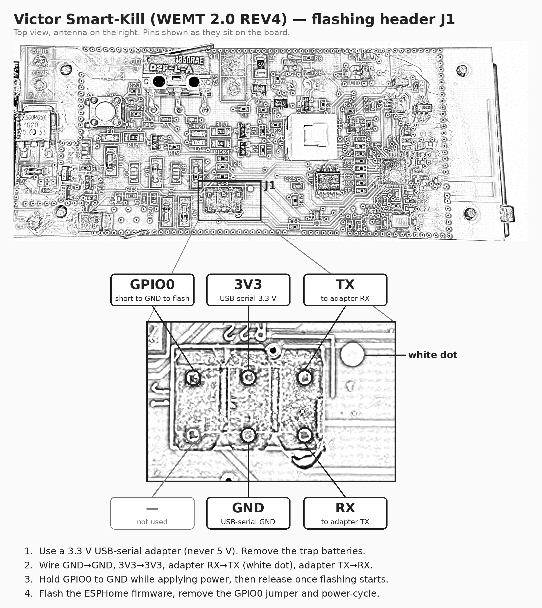

# 🪤 Local-Kill

**Local, cloud-free ESPHome firmware for the Victor® Smart-Kill™ electronic mouse trap.**

Victor's cloud is shutting down, which bricks the "smart" half of a perfectly good
trap. Local-Kill replaces that cloud with your own Home Assistant — no account, no
servers, no internet. Catch detection, the kill cycle, battery monitoring, and
reporting all run on the trap's own ESP8266 and talk only to your LAN.

> Built as a right-to-repair project for hardware I own, to keep a working device
> out of the landfill. Not affiliated with or endorsed by Woodstream / Victor. The
> stock firmware is **not** redistributed here — this is independent firmware that
> reimplements the behavior from the hardware up.

> ✅ **Status: it works — first confirmed field kill.** The full chain — hardware wake
> on a catch, the HV kill cycle, post-shock kill confirmation, battery reporting and the
> deep-sleep heartbeat — has caught and killed a mouse in the field, not just on the bench.
>
> Still **pre-1.0 by choice.** The newest change — a short post-wake *bridge watch* that
> re-checks the plates (so a mouse that isn't shorting them at the exact wake instant still
> gets caught) — landed *after* that kill and hasn't been field-proven yet; the confirmed
> kill was on the previous build. A **1.0** tag will follow once the bridge-watch catches
> one in the field. Until then, treat it as working-but-tuning and calibrate to your own hardware.

📓 **Changelog:** notable changes are tracked in [CHANGELOG.md](CHANGELOG.md).

---

## What it does

- 🔌 **100% local** — native Home Assistant API (encrypted), no cloud, no DNS tricks.
- 🐭 **Catch detection** — hardware wake the instant the plates are bridged.
- ⚡ **Kill cycle** — 10 s high-voltage pulse on **every** catch (always live).
- 🔋 **Battery monitoring** — gated divider read, sampled once per wake to sip power.
- 😴 **Deep sleep** — reports to HA roughly once a day, like the stock trap. The
  ESP8266 can't single-sleep beyond ~3.5 h, so it chains short ~2 h chunks (counted
  in RTC memory) and only brings up WiFi on the 12th (~24 h). Catches and the button
  wake it instantly in between via the hardware reset line.
- 🧹 **"Needs cleaning" flag + re-fire lockout** — a confirmed kill latches this flag,
  which **disarms the trap** so it won't re-zap the corpse (or inflate the count) on
  later wakes. It stays latched until you service the trap (see **Servicing** below).
- 💡 **At-a-glance LEDs** — green *breathes* while connecting, then goes *solid* once
  linked to HA; blue lights in AP/setup mode (not connected); red marks a catch that
  needs cleaning.
- 🔴 **Optional walk-by indicator** — slow red blink on an uncleaned kill, for when
  you'd rather glance at the trap than open the app.
- 🔢 **Multi-trap friendly** — the MAC is appended to the device name, so one config
  flashes to any number of traps without collisions.

## Hardware

Victor Smart-Kill, **Woodstream WEMT 2.0 REV4** board (ESP8266EX, 512 KB flash — AT25SF041).
Other revisions may differ — check your pin map before flashing.

| GPIO | Function |
|------|----------|
| 12 | Catch sense (active-low) |
| 0  | Battery-divider enable (drive low to sample; **high at boot**) |
| 13 + 2 | HV transformer drive (PWM, 230.6 Hz) |
| 15 | Green LED — breathing status (PWM) |
| 14 | Red LED — catch / needs cleaning |
| 5  | Blue LED — Wi-Fi icon, lit in AP/setup mode |
| A0 | Battery voltage (via GPIO0-gated divider) |
| 1 / 3 | Used by the board — **keep UART logging off** |

## Back up the stock firmware first

**Do this before you flash anything.** Reading the trap's entire flash to a file gives
you a one-command path back to a bone-stock trap if you change your mind or something
goes sideways — which is the whole point of feeling safe trying this.

Wire the **J1 header** exactly as in the [Flashing](#flashing) table below (3.3 V serial,
GPIO0 to GND at power-up for download mode), then dump the full chip:

```bash
# sanity check: the adapter should see the chip and print its flash size + MAC
esptool.py --port COM3 flash_id

# dump the whole 512 KB flash (0x80000) to a file — adjust the port to yours
esptool.py --port COM3 --baud 115200 read_flash 0x0 0x80000 victor-stock-backup.bin
```

Use `/dev/ttyUSB0` (Linux) or `/dev/tty.usbserial-*` (macOS) in place of `COM3`.
Dumping the whole `0x0`–`0x80000` range (not just the app) captures the bootloader and
the device's calibration/credentials, so the restore is truly complete.

**Restoring stock** is the reverse — write that same file back to `0x0`:

```bash
esptool.py --port COM3 --baud 115200 write_flash 0x0 victor-stock-backup.bin
```

A few notes:
- **Keep your backup private.** It's the stock image for *your* device and can contain its
  Wi-Fi/cloud credentials — it's for restoring your own trap, not for sharing or re-posting.
- **Check the dump before you trust it.** A 512 KB file that's all `0xFF` or all `0x00` means
  the read failed (bad wiring or not in download mode) — redo it before overwriting anything.
- Same wiring and download-mode steps apply to both the read and the write.

## Flashing

### Wiring the J1 header



J1 is the 2×3 header in the middle of the board, with a white dot beside its top-right pin.
Use a **3.3 V** USB-serial adapter (never 5 V):

| J1 pin | Connect to |
|--------|------------|
| Top-left — GPIO0 | GND while powering up (download mode) |
| Top-middle — 3V3 | Adapter 3.3 V |
| Top-right (white dot) — TX | Adapter RX |
| Bottom-middle — GND | Adapter GND |
| Bottom-right — RX | Adapter TX |
| Bottom-left | Not used |

### Steps

1. Create `secrets.yaml` next to the config:
   ```yaml
   wifi_ssid: "your-ssid"
   wifi_password: "your-wifi-password"
   ap_password: "fallback-hotspot-password"
   api_key: "<32-byte base64>"      # e.g. `openssl rand -base64 32`
   ```
2. First flash over USB-serial (the board speaks UART download; GPIO0 low at reset):
   ```bash
   esphome run victor-trap-esphome.yaml
   ```
3. Add it in Home Assistant → **Settings → Devices & Services → ESPHome**. It appears
   as `local-kill-<mac>`; enter the `api_key` when prompted.
4. If Wi-Fi ever fails, the trap raises a `local-kill-setup` hotspot for reconfiguration.

> **Flash size:** this board uses a 512 KB flash (AT25SF041). That's too small for
> OTA (which needs room to stage a second image), so `board: esp01` is set and
> **updates are flashed over USB-serial**, not OTA.

> **Logs:** the board uses GPIO1/3 for its own hardware, so serial logging is
> disabled. View logs over the network via the ESPHome API instead.

> **Always live:** HV fires on every confirmed catch — there is no arm/disarm. Treat
> the trap as hot the instant it's powered: bridging the plates (a finger, a tool, a
> stray wire) will trigger the 10 s pulse. Keep it **unpowered** while assembling or
> handling, and only power it once it's placed.

## Servicing (after a catch)

A confirmed kill (plates still bridged after the shock) sets **Needs cleaning** and
**latches the trap off** — it will *not* fire again on anything, so the dead mouse
isn't re-zapped every wake and the kill count stays honest. This is deliberate and
mirrors the stock trap's "needs cleaned" behavior.

Re-arming is a **physical action at the trap** (an HA button is no good here — the trap
is asleep almost all the time and only reachable for a few seconds a day). After you've
emptied the trap so the plates are clear, do either:

- Press the trap's **Wi-Fi button**, or
- **Power-cycle** it (pop a battery and back in).

Either one, with the plates clear, clears the lockout and re-arms. If the plates are
still bridged (body not removed) it won't clear — so you can't accidentally re-arm onto
a corpse. Until you service it, the trap stays disarmed. (The flag lives in flash, so it
survives deep sleep and battery changes.)

## Configuration knobs

In `substitutions:` at the top of `victor-trap-esphome.yaml`:

| Key | Default | Meaning |
|-----|---------|---------|
| `node_name` | `local-kill` | Base device name (MAC suffix added automatically) |
| `hv_duty` | `0.284` | HV PWM duty (static) |
| `chunk_sleep` | `2h` | One deep-sleep chunk (keep under the ESP8266 ~3.5 h limit) |
| `report_cycles` | `12` | WiFi report every N chunks (12 × 2h ≈ 24 h) |
| `retry_sleep` | `10min` | Sleep if HA didn't connect on a report wake |
| `api_timeout` | `60s` | How long to wait for HA before retrying |
| `hv_settle` | `100ms` | Rail-settle delay after boot before the HV fire |
| `catch_window_ms` | `5000` | How long (ms) to watch the plates after a wake and fire the instant they bridge |

Battery scaling lives on the `Battery voltage` sensor (`multiply: 6.44`) and the
`Battery %` thresholds (`VFULL` / `VEMPTY`) — recalibrate for your pack.

## Home Assistant entities

- **Battery voltage**, **Battery %**, **Kill total**
- **Plates bridged** (binary), **Needs cleaning** (binary, Problem), **Status** (binary, connectivity)
- **Status LED** (green light — breathes while connecting, solid once linked to HA)
- **Wake reason** (diagnostic text — Scheduled / Catch / Button / Power on)
- **Stay awake**, **Walk-by red indicator** (switches)
- **HV test 3s** (button — caution: energizes the plates)

## ⚠️ Safety

This trap generates **high voltage** to kill rodents, and this firmware is **always
live** — any confirmed catch energizes the plates, there is no arm/disarm. Keep it
**unpowered** until it's fully assembled and placed, keep fingers clear, and don't
bench-fire it near anything conductive. The HV test button energizes the plates on
demand too. You are responsible for operating your own hardware safely.

## License

MIT for the config and docs in this repo. Victor® and Smart-Kill™ are trademarks of
Woodstream Corporation; this project is independent and unaffiliated.
