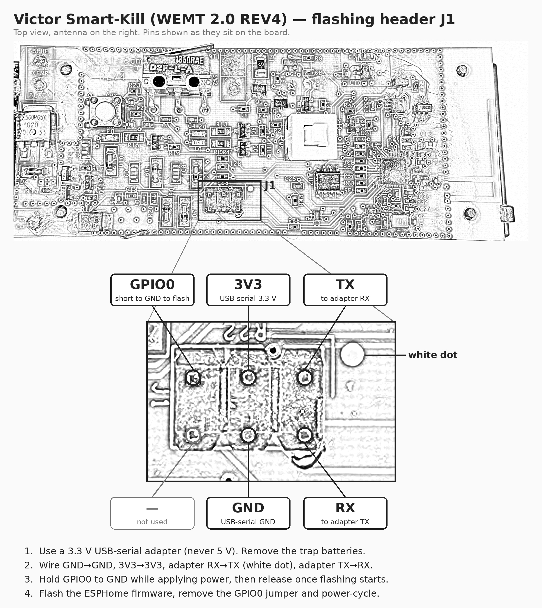

# 🪤 Local-Kill

**Local, cloud-free ESPHome firmware for the Victor® Smart-Kill™ electronic mouse trap.**

Victor's cloud is shutting down, which bricks the "smart" half of a perfectly good
trap. Local-Kill replaces that cloud with your own Home Assistant — no account, no
servers, no internet. Catch detection, the kill cycle, battery monitoring, and
reporting all run on the trap's own ESP8266 and talk only to your LAN.

> Built as a right-to-repair project for hardware I own, to keep a working device
> out of the landfill. Not affiliated with or endorsed by Woodstream / Victor. The
> stock firmware is **not** redistributed here — this is independent firmware that
> reimplements the behavior from the hardware up.

---

## What it does

- 🔌 **100% local** — native Home Assistant API (encrypted), no cloud, no DNS tricks.
- 🐭 **Catch detection** — hardware wake the instant the plates are bridged.
- ⚡ **Kill cycle** — 10 s high-voltage pulse on catch (armable; off = log only).
- 🔋 **Battery monitoring** — gated divider read, sampled once per wake to sip power.
- 😴 **Deep sleep** — reports to HA roughly once a day, like the stock trap. The
  ESP8266 can't single-sleep beyond ~3.5 h, so it chains short ~2 h chunks (counted
  in RTC memory) and only brings up WiFi on the 12th (~24 h). Catches and the button
  wake it instantly in between via the hardware reset line.
- 🧹 **"Needs cleaning" flag** — set on a catch, visible in HA, clears on a fresh boot.
- 💡 **At-a-glance LEDs** — green *breathes* while awake/reporting, blue lights in
  AP/setup mode (not connected), red marks a catch that needs cleaning.
- 🔴 **Optional walk-by indicator** — slow red blink on an uncleaned kill, for when
  you'd rather glance at the trap than open the app.
- 🔢 **Multi-trap friendly** — the MAC is appended to the device name, so one config
  flashes to any number of traps without collisions.

## Hardware

Victor Smart-Kill, **Woodstream WEMT 2.0 REV4** board (ESP8266EX, 512 KB flash — AT25SF041).
Other revisions may differ — check your pin map before flashing.

| GPIO | Function |
|------|----------|
| 12 | Catch sense (active-low) |
| 0  | Battery-divider enable (drive low to sample; **high at boot**) |
| 13 + 2 | HV transformer drive (PWM, 230.6 Hz) |
| 15 | Green LED — breathing status (PWM) |
| 14 | Red LED — catch / needs cleaning |
| 5  | Blue LED — Wi-Fi icon, lit in AP/setup mode |
| A0 | Battery voltage (via GPIO0-gated divider) |
| 1 / 3 | Used by the board — **keep UART logging off** |

## Flashing

### Wiring the J1 header



J1 is the 2×3 header in the middle of the board, with a white dot beside its top-right pin.
Use a **3.3 V** USB-serial adapter (never 5 V):

| J1 pin | Connect to |
|--------|------------|
| Top-left — GPIO0 | GND while powering up (download mode) |
| Top-middle — 3V3 | Adapter 3.3 V |
| Top-right (white dot) — TX | Adapter RX |
| Bottom-middle — GND | Adapter GND |
| Bottom-right — RX | Adapter TX |
| Bottom-left | Not used |

### Steps

1. Create `secrets.yaml` next to the config:
   ```yaml
   wifi_ssid: "your-ssid"
   wifi_password: "your-wifi-password"
   ap_password: "fallback-hotspot-password"
   api_key: "<32-byte base64>"      # e.g. `openssl rand -base64 32`
   ```
2. First flash over USB-serial (the board speaks UART download; GPIO0 low at reset):
   ```bash
   esphome run victor-trap-esphome.yaml
   ```
3. Add it in Home Assistant → **Settings → Devices & Services → ESPHome**. It appears
   as `local-kill-<mac>`; enter the `api_key` when prompted.
4. If Wi-Fi ever fails, the trap raises a `local-kill-setup` hotspot for reconfiguration.

> **Flash size:** this board uses a 512 KB flash (AT25SF041). That's too small for
> OTA (which needs room to stage a second image), so `board: esp01` is set and
> **updates are flashed over USB-serial**, not OTA.

> **Logs:** the board uses GPIO1/3 for its own hardware, so serial logging is
> disabled. View logs over the network via the ESPHome API instead.

## Configuration knobs

In `substitutions:` at the top of `victor-trap-esphome.yaml`:

| Key | Default | Meaning |
|-----|---------|---------|
| `node_name` | `local-kill` | Base device name (MAC suffix added automatically) |
| `hv_duty` | `0.284` | HV PWM duty (static) |
| `chunk_sleep` | `2h` | One deep-sleep chunk (keep under the ESP8266 ~3.5 h limit) |
| `report_cycles` | `12` | WiFi report every N chunks (12 × 2h ≈ 24 h) |
| `retry_sleep` | `10min` | Sleep if HA didn't connect on a report wake |
| `api_timeout` | `60s` | How long to wait for HA before retrying |

Battery scaling lives on the `Battery voltage` sensor (`multiply: 6.44`) and the
`Battery %` thresholds (`VFULL` / `VEMPTY`) — recalibrate for your pack.

## Home Assistant entities

- **Battery voltage**, **Battery %**, **Kill total**
- **Catch line** (binary), **Needs cleaning** (binary, Problem)
- **Status LED** (green light — breathes while awake)
- **Arm trap**, **Stay awake**, **Walk-by red indicator** (switches)
- **HV test 3s**, **Sample battery now**, **Mark cleaned** (buttons)

## ⚠️ Safety

This trap generates **high voltage** to kill rodents. The HV test button and the
armed kill cycle energize the plates. Keep fingers clear, don't bench-fire it near
anything conductive, and leave it **disarmed** until it's assembled and placed. You
are responsible for operating your own hardware safely.

## License

MIT for the config and docs in this repo. Victor® and Smart-Kill™ are trademarks of
Woodstream Corporation; this project is independent and unaffiliated.
